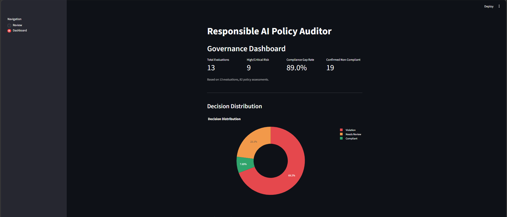

# Responsible AI Policy Auditor

A working AI governance application that evaluates AI systems and AI-generated content against multiple frameworks at the same time, and produces **evidence-based, auditable findings** instead of a single opaque score.

> Portfolio project (1 of 6) in an AI Governance / Responsible AI track. Educational use only, not legal advice.

---

## What it does

You describe an AI system (or paste content such as a prompt or an AI response). The app:

1. Identifies the **risks** it sees (one finding per risk category).
2. Scores each risk with **Likelihood × Impact**.
3. Checks each finding against **OWASP, NIST AI RMF, ISO/IEC 42001, EU AI Act and GDPR**, plus any **company policy** you upload.
4. Reports, for every check, the **evidence** it relied on and a status: `Compliant`, `Evidence Required` or `Non-Compliant`.
5. Logs everything to a local database and shows a **governance dashboard**.

Reports can be generated in **Arabic or English**. Evidence is quoted in the language of the original input.

---

## Key design decisions

**Two-stage pipeline.** Stage 1 identifies risks without being biased toward any policy. Stage 2 maps each risk to the relevant policy requirements.

**Risk and compliance are separate engines.**

| Engine | Question it answers | Based on |
|---|---|---|
| Risk Engine | If this goes wrong, how bad is it? | Likelihood × Impact (1-4 Low, 5-9 Medium, 10-19 High, 20-25 Critical) |
| Compliance Engine | Is there documented evidence that the safeguard exists? | Evidence status only |

A low-risk system is not automatically compliant, and a high-risk system is not automatically non-compliant.

**Fixed invariants**

- Absence of evidence is not proof of a violation, it is `Evidence Required`.
- Contradicting evidence is always `Non-Compliant`.
- Risk level never decides compliance.
- Each finding gets one compliance status (worst case across its policy checks), and the final decision is the worst case across findings: `Violation`, `Needs Review` or `Compliant`.
- The same fact is not counted as independent evidence across several frameworks.

**Conservative by design.** The tool prefers a false `Needs Review` over a false `Compliant`.

**AI system registry.** Each assessed system gets a stable ID. Re-assessing the same system adds a new evaluation under the same ID, so the history is preserved as an audit trail.

---

## Features

- System intake questionnaire (identity, data, oversight), modeled on EU AI Act Annex IV
- Content review mode (prompts, AI responses, full conversations, system descriptions)
- Multi-risk detection with 11 risk categories
- Policy management: built-in frameworks plus uploadable company policies (PDF/TXT) with a confirmation step
- Evidence, matched policy and source shown for every finding
- SQLite audit log: `systems`, `evaluations`, `findings`, `policy_violations`
- Governance dashboard: KPIs, decision distribution, risk levels, findings by category, compliance status per framework

### Risk categories

`prompt_injection`, `sensitive_data_exposure`, `privacy_data_protection`, `bias_fairness`, `human_oversight`, `transparency_explainability`, `hallucination_reliability`, `security_misconfiguration`, `data_governance_minimization`, `violence_harmful_content`, `self_harm_content`

---

## Screenshots

<!-- Add screenshots to docs/screenshots/ and update the paths -->

| Review report | Dashboard |
|---|---|
|  |  |

---

## Tech stack

Python 3.13, Streamlit, Plotly, pandas, SQLite, ChromaDB, sentence-transformers, Groq API (`openai/gpt-oss-120b`, temperature 0).

## Project structure

```
app.py                  Streamlit UI (Review + Dashboard)
src/evaluator.py        Risk identification, policy mapping, engines
src/retriever.py        Retrieval over the policy knowledge base
src/knowledge_base.py   Policy ingestion
src/embedder.py         Embedding model
src/db.py               SQLite logging and registry
src/dashboard.py        Dashboard charts and KPIs
data/                   Framework sources and summaries
```

## Run locally

```bash
python -m venv venv
venv\Scripts\activate
python -m pip install -r requirements.txt
```

Create a `.env` file with your Groq API key:

```
GROQ_API_KEY=your_key_here
```

Then start the app:

```bash
python -m streamlit run app.py
```

---

## Scope and limitations

This project is intentionally limited. Known limits:

- **Framework sources.** OWASP and NIST are indexed from the original documents. ISO/IEC 42001, EU AI Act and GDPR are indexed from **original summaries written for this project**, not the full legal texts. Their references therefore show the summary (`p. 1`), not article numbers.
- **LLM-based assessment.** Wording can vary between runs. Findings are a starting point for a human reviewer, not a legal conclusion.
- **Human decisions are not recorded.** Reports recommend that a reviewer records an accept / reject / escalate decision, but the tool does not store it.
- **Input quality drives output.** A short description gives a more cautious result because the evidence is missing, not because the system is non-compliant.

### Planned enhancements (not implemented)

- Model performance and drift monitoring
- Detailed third-party / vendor risk assessment (certifications, SLAs, audit rights)
- Incident response and post-deployment monitoring
- Redress mechanism for people affected by automated decisions
- Environmental impact
- Prompt-injection detection for Egyptian Arabic and Arabizi (ArabGuard benchmark)
- Control-level gap assessment (covered in a separate portfolio project)
- Agent-specific assessment: AI agents are handled in a separate portfolio project (AI Agent Governance & Assurance)
