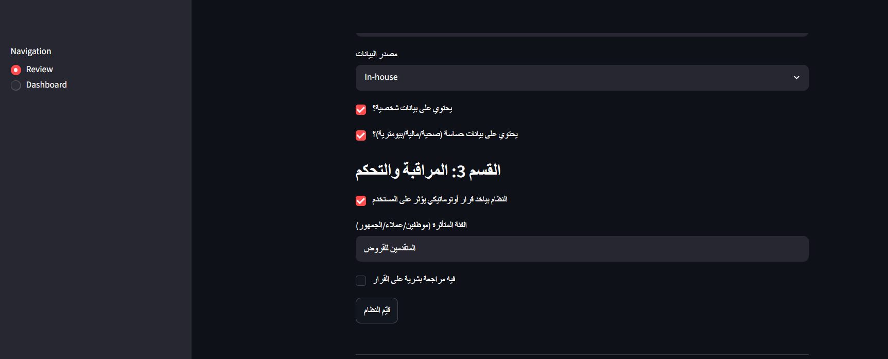
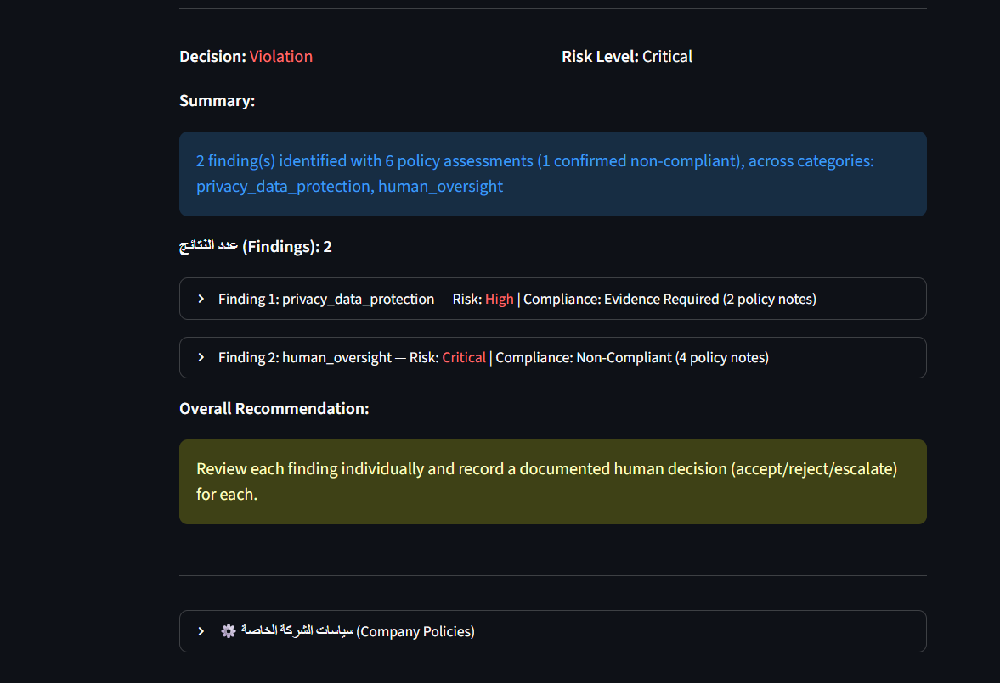
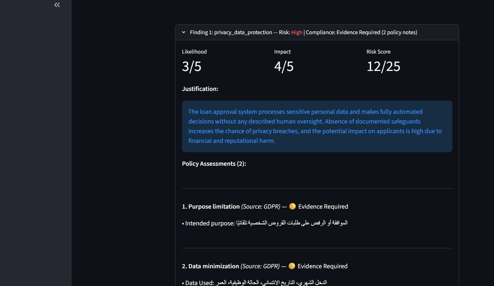

# Case Study: Auditing a Fully Automated Loan Approval System

A walk-through of one real run of the Responsible AI Policy Auditor. The system is fictional and the results are illustrative, not legal advice.

---

## 1. The scenario

A bank uses an AI system to approve or reject personal loan applications automatically. It reads the applicant's income, credit history, employment status and age. There is no human review of its decisions.

This scenario was chosen because it combines several governance concerns at once: personal and financial data, a fully automated decision with real impact on people, and no human oversight.

## 2. Input

The system was described through the intake questionnaire.

| Field | Value |
|---|---|
| System name | Loan Approval System |
| Entity type | AI System |
| Source | In-house |
| Intended purpose | Approve or reject personal loan applications automatically |
| Interacts with | The bank's customer management system |
| Data used | Monthly income, credit history, employment status, age |
| Data source | In-house |
| Personal data | Yes |
| Sensitive data (financial) | Yes |
| Automated decision affecting the user | Yes |
| Affected group | Loan applicants |
| Human review of the decision | No |
| Report language | English |

## 3. Result at a glance

| | |
|---|---|
| **Decision** | Violation |
| **Overall risk level** | Critical |
| **Findings** | 2 |
| **Policy assessments** | 6 (1 confirmed non-compliant) |

The decision is the worst case across all findings, and the overall risk level is the highest finding risk. One confirmed non-compliant assessment is enough for an overall `Violation`.

## 4. Finding 1: privacy and data protection

| | |
|---|---|
| Risk | **High** (Likelihood 3 × Impact 4 = 12/25) |
| Compliance | **Evidence Required** |

Two GDPR checks were run, and both came back `Evidence Required`:

- **Purpose limitation.** The stated purpose is automated loan approval, but nothing documents that the purpose is specified and limited.
- **Data minimization.** The data listed is relevant to credit decisions, but nothing shows it is limited to what is necessary.

The risk is high because sensitive financial data is processed and the impact on applicants could be significant. The status is not `Non-Compliant`, because the input describes **missing information**, not a confirmed breach. That is the intended behavior.

## 5. Finding 2: human oversight

| | |
|---|---|
| Risk | **Critical** (Likelihood 4 × Impact 5 = 20/25) |
| Compliance | **Non-Compliant** |

Four checks were run:

| Framework | Requirement | Status |
|---|---|---|
| GDPR | Meaningful human review of automated decisions | **Non-Compliant** |
| EU AI Act | Human oversight must be built in | Evidence Required |
| ISO/IEC 42001 | Human oversight proportionate to risk | Evidence Required |
| NIST AI RMF | Human judgment for trustworthiness metrics | Evidence Required |

The input states clearly that there is no human review, which is direct evidence against the GDPR requirement. The same fact is **not counted as independent proof** against the other three frameworks, so they stay `Evidence Required` and a reviewer must confirm how each framework applies.

## 6. What this case shows about the design

**Risk and compliance are independent.** Finding 1 is High risk but only `Evidence Required`. Finding 2 is Critical risk and `Non-Compliant`. A high risk level did not turn into a violation by itself.

**Missing evidence is not a violation.** Gaps in documentation produce `Evidence Required`. Only evidence that contradicts a requirement produces `Non-Compliant`.

**No double counting.** One fact (no human review) is confirmed against one framework, not turned into four violations.

**Evidence stays in the original language.** The report is in English, but evidence is quoted in the language of the input (Arabic in this case), so a reviewer can verify it against what was actually submitted.

## 7. What the report recommends

For human oversight: add a meaningful human review step before final decisions, define escalation procedures for borderline or high-risk applications, document and audit the oversight process, train reviewers, and monitor for biased or erroneous outcomes.

For privacy: run a privacy impact assessment, document the lawful basis, apply privacy-enhancing techniques where feasible, and give applicants clear notices about how their data is used.

The report ends by asking a reviewer to record a documented decision (accept / reject / escalate) for each finding.

## 8. Observations and limits

- Recommendations in Finding 1 partly overlap with Finding 2 (for example, a human review step appears under privacy). A reviewer should read them together.
- The lawful-basis recommendation is generic. The correct basis depends on the context and should be decided and documented by the organization.
- Wording varies between runs because the assessment is LLM-based. The structure and statuses are what to rely on.
- The tool does not store the reviewer's decision. That step stays manual.
- ISO/IEC 42001, EU AI Act and GDPR are indexed from summaries written for this project, so sources show `p. 1` for them.

## 9. Takeaway

From a short description of the system, the tool separated two problems of different severity, confirmed the one it had direct evidence for, flagged the rest as needing evidence, and gave a reviewer a clear starting point instead of a single score.
